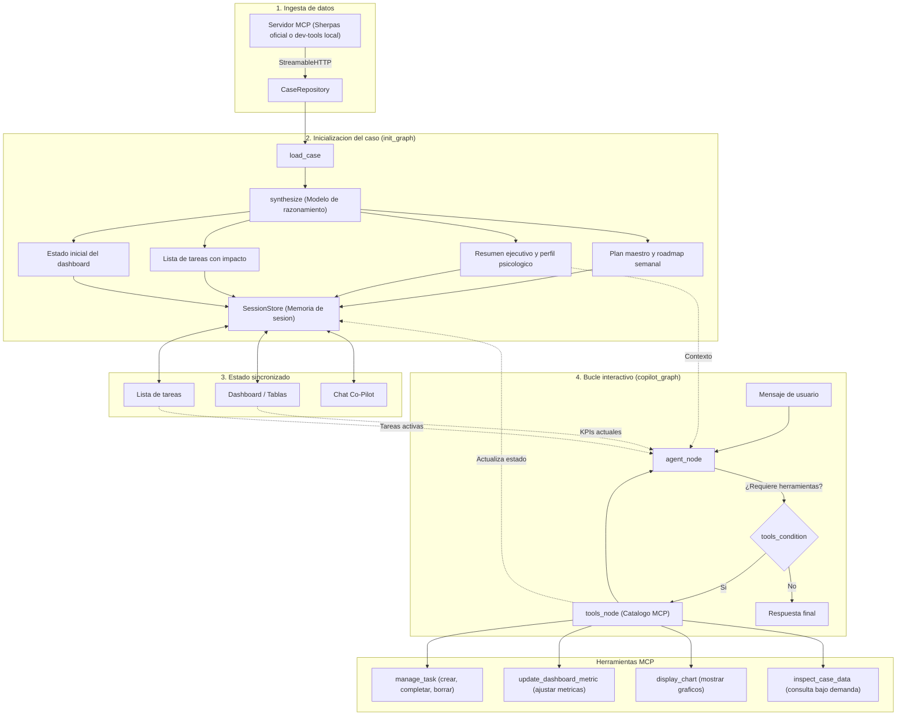

# Arquitectura del Sistema: Sherpas Wealth Co-Pilot

Documento tecnico de referencia que describe el diseño, los componentes y la implementacion del backend para la experiencia interactiva de Sherpas Wealth.

---

## 1. Vision general

El proyecto convierte los informes financieros estaticos generados por Sherpas (actualmente documentos de decenas de paginas en PDF o JSONs extensos) en un entorno interactivo centrado en tres paneles:

1. **Dashboard financiero:** Visualizacion de metricas clave (patrimonio, liquidez, deuda, salud financiera) y tablas de proyeccion. La estructura interna de este panel se mantiene flexible para adaptarse al formato final de hoja de calculo.
2. **Lista de tareas:** Plan de accion estructurado por semanas, encabezado por una accion prioritaria inmediata pensada para ejecutarse en pocos minutos, con impacto cuantificado.
3. **Chat interactivo (Co-Pilot):** Asistente conversacional construido sobre LangGraph que razona sobre el caso, responde preguntas y actualiza el estado del dashboard y las tareas mediante herramientas predefinidas.

---

## 2. Diagrama de arquitectura



---

## 3. Pipeline de procesamiento

### 3.1. Ingesta (`CaseRepository`)
Los datos de cada hogar se consumen de forma estricta y exclusiva a traves del protocolo MCP (StreamableHTTP), apuntando a `MCP_URL`. No existen fallbacks locales ni datos inventados en el backend: si el servidor MCP no responde, se emite un error HTTP 502 claro y directo. Para pruebas en local o desarrollo offline, se utiliza el servidor clon local `dev-tools/mcp_server.py`, permitiendo cambiar entre entorno local y remoto unicamente modificando `MCP_URL` en `.env`.

### 3.2. Inicializador maestro (`init_graph`)
Se ejecuta una unica vez por caso seleccionado. Envia el caso integro (~45.000 tokens) a un modelo de razonamiento (`gpt-5-mini` o `gemini-3.5-flash-lite`) para generar en una sola pasada:
- **Resumen ejecutivo condensado (~1.500 tokens):** Sintetiza la situacion patrimonial, los cuellos de botella y las tensiones del perfil psicologico (`persona.md`, dimensiones D0 a D6). Este resumen se reutiliza en cada turno del chat para mantener el contexto sin reenviar el caso completo.
- **Accion inmediata y roadmap:** Define el primer paso concreto y una guia de 4 semanas.
- **Tareas iniciales:** Tareas accionables con metricas de impacto estimadas (ahorro mensual, reduccion de deuda o variacion de score).
- **Estado inicial del dashboard:** Metricas globales calculadas (patrimonio neto, activos, pasivos, ingresos, gastos y ahorro libre).

### 3.3. Bucle conversacional (`copilot_graph`)
Implementa un patron ReAct sobre LangGraph:
- Recibe la entrada del usuario junto al resumen del caso, los KPIs del dashboard y las tareas actuales.
- El modelo evalua si la consulta requiere modificar el estado de la aplicacion o consultar detalles adicionales. Si es necesario, invoca herramientas y procesa los resultados antes de responder.
- Si no se requieren mas acciones, emite la respuesta conversacional y finaliza el ciclo.

---

## 4. Componentes de la interfaz y modelo de datos

### Dashboard financiero
El modelo `DashboardState` almacena los indicadores globales y un conjunto flexible de filas tabulares:
- **Metricas principales:** `health_score`, `net_worth`, `total_assets`, `total_liabilities`, `monthly_income`, `monthly_expenses`, `monthly_free_cashflow`.
- **Estructura tabular (`sheet_data`):** Lista de registros (`id`, `concept`, `current_value`, `target_value`, `delta`, `frequency`, `notes`). Esta estructura agnostica permite conectar el backend a cualquier diseño final de hoja de calculo sin modificar la logica del agente.

### Lista de tareas
- **Accion inmediata (`ImmediateAction`):** Accion inicial explicada paso a paso para reducir la barrera de entrada y la paralisis del cliente.
- **Roadmap semanal (`WeeklyRoadmap`):** Bloques semanales tematicos orientados a estabilizacion de deuda, fondo de reserva, proteccion y optimizacion de inversion.
- **Impacto asociado (`TaskImpact`):** Cada tarea vincula su ejecucion con un efecto medible (ejemplo: `+$350/mes`, `-$18.000 de deuda`) y una breve justificacion practica.

### Chat Co-Pilot
- Permite al usuario plantear dudas, solicitar cambios en su planificacion o simular variaciones en sus ingresos o gastos.
- Emplea `inspect_case_data` para consultar secciones especificas de los JSON originales cuando surgen preguntas de detalle, evitando alucinaciones y sin necesidad de montar una base de datos vectorial.

---

## 5. Catalogo de herramientas (MCP)

| Herramienta | Parametros | Funcion |
|---|---|---|
| `manage_task` | `action` (add, complete, delete), `task_id`, `title`, `week`, `impact_value` | Modifica las tareas activas en la interfaz. |
| `update_dashboard_metric` | `key`, `value`, `reason` | Modifica indicadores o valores del dashboard y registra el motivo del cambio. |
| `display_chart` | `chart_type` (bar, line, donut), `title`, `categories`, `values` | Solicita al frontend la renderizacion de un grafico comparativo o de proyeccion. |
| `inspect_case_data` | `part` (financial-health, investment-analysis, persona), `section` | Lee datos puntuales del caso original bajo demanda. |

---

## 6. Estructura del codigo (`backend/app/`)

```
backend/
├── app/
│   ├── config.py                 # Configuracion del entorno (modelos, URLs, puertos)
│   ├── main.py                   # Inicializacion de FastAPI, middleware CORS y routers
│   ├── models/                   # Definicion de esquemas Pydantic
│   │   ├── case.py               # Modelos de casos y participantes
│   │   ├── plan.py               # Modelos de plan, tareas y roadmap
│   │   ├── dashboard.py          # Estado del dashboard y metricas tabulares
│   │   └── chat.py               # Mensajes de chat y registros de herramientas
│   ├── services/
│   │   ├── case_repository.py    # Consumo exclusivo del servidor MCP via StreamableHTTP
│   │   ├── llm_factory.py        # Configuracion de clientes LLM sobre el proxy de Sherpas
│   │   └── session_store.py      # Almacen de estado en memoria por sesion
│   ├── tools/
│   │   └── copilot_tools.py      # Definicion de herramientas LangChain / MCP
│   ├── graphs/
│   │   ├── state.py              # Definicion de estados para LangGraph
│   │   ├── init_graph.py         # Grafo de inicializacion y sintesis del caso
│   │   └── copilot_graph.py      # Grafo ciclico ReAct para el chat interactivo
│   └── api/
│       ├── cases.py              # Consulta de casos y secciones
│       ├── init.py               # Disparo de la inicializacion maestra
│       ├── chat.py               # Endpoint principal de conversacion
│       ├── tasks.py              # Gestion REST de tareas
│       └── dashboard.py          # Consulta y edicion directa del dashboard
```

---

## 7. Endpoints de la API

| Metodo | Ruta | Descripcion |
|---|---|---|
| `GET` | `/api/cases` | Lista los casos disponibles con su puntuacion basica. |
| `GET` | `/api/cases/{case_id}` | Devuelve la informacion completa del caso. |
| `GET` | `/api/cases/{case_id}/section` | Consulta una seccion especifica de un caso bajo demanda. |
| `POST` | `/api/cases/{case_id}/init` | Ejecuta la inicializacion maestra y devuelve el plan, resumen, tareas y estado inicial. |
| `POST` | `/api/chat` | Envia un mensaje al agente y devuelve la respuesta JSON junto a las modificaciones de estado. |
| `POST` | `/api/chat/stream` | Endpoint SSE para streaming en tiempo real de tokens, llamadas a tools y mutaciones de estado. |
| `GET` | `/api/cases/{case_id}/tasks` | Obtiene la lista actual de tareas del caso. |
| `PATCH` | `/api/cases/{case_id}/tasks/{task_id}` | Actualiza el estado o descripcion de una tarea. |
| `POST` | `/api/cases/{case_id}/tasks` | Crea una nueva tarea de forma manual. |
| `GET` | `/api/cases/{case_id}/dashboard` | Devuelve el estado actual de metricas y datos del dashboard. |
| `PATCH` | `/api/cases/{case_id}/dashboard` | Actualiza una metrica puntual en el dashboard. |
| `GET` | `/health` | Comprobacion de estado del servicio (`{"status": "ok"}`). |

---

## 8. Puesta en marcha

1. Comprobar la presencia del archivo `.env` en la raiz del repositorio con las credenciales y modelos:
   ```env
   # Proxy LLM (OpenAI-compatible: Sherpas o OpenRouter)
   LLM_PROXY_URL=https://openrouter.ai/api/v1
   TEAM_KEY=tu-api-key-aqui
   FAST_MODEL=openai/gpt-4o-mini
   REASONING_MODEL=openai/gpt-4o-mini
   CHAT_MODEL=openai/gpt-4o-mini

   # Servidor MCP de casos (Servidor oficial de Sherpas o clon local)
   MCP_URL=https://mcp-hackathon.sherpaswealth.com/mcp
   MCP_TOKEN=tu-token-mcp-aqui

   PORT=8000
   HOST=0.0.0.0
   CORS_ORIGINS=*
   ```

2. (Opcional) Levantar el servidor MCP local para pruebas offline:
   ```bash
   .venv/bin/python dev-tools/mcp_server.py --port 8001
   ```
   *Y en `.env` fijar `MCP_URL=http://127.0.0.1:8001/mcp`.*

3. Levantar el servidor backend FastAPI:
   ```bash
   .venv/bin/uvicorn backend.app.main:app --reload --port 8000
   ```

4. Acceso a la documentacion interactiva:
   - Swagger UI: `http://localhost:8000/docs`
   - ReDoc: `http://localhost:8000/redoc`
